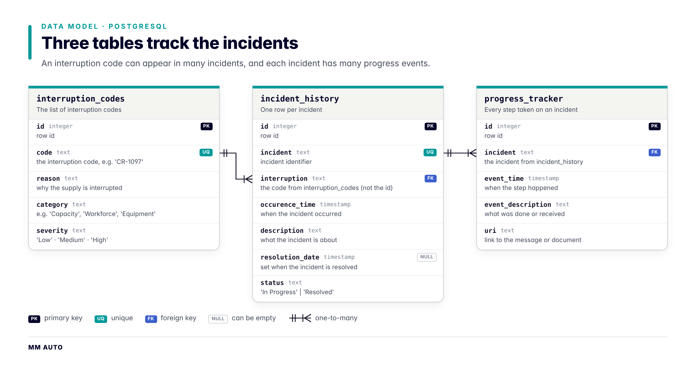
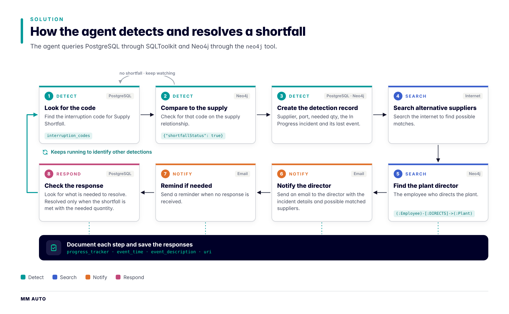

# MM AUTO

**An agentic approach in factory automation**

## 1. Introduction

In car manufacturing, when a supplier cannot deliver a part, someone has to notice it, find alternative suppliers, notify the appropriate stakeholders, follow up until they respond, and record the outcome.

***MM AUTO*** applies an agentic approach to factory automation. it hands that work to an agent so supply shortfalls are resolved timely and every step is logged.

### The Manufacturing Data

To model the complex relationship in a car manufacturing company, **NEO4J** was used. It suits this application as it can capture the relationship deepth that exists in the data. 

- **Nodes:** `Car`, `System`, `Part`, `Material`, `Supplier`, `Plant`, `Line`, `Station`, `Employee`, `Shift`. Every node has an `id`.
- **Relationships:**
  - A `Supplier` `SUPPLIES` a `Part`.
  - A `Part` is a `COMPONENT_OF` a `System` and is `MADE_OF` a `Material`.
  - A `Car` `USES` a `System`.
  - A `Line` `PRODUCES` parts, `ASSEMBLES` systems and sits `IN` a `Plant`.
  - A `Station` is `AT` a `Line`.
  - An `Employee` is `ASSIGNED_TO` a `Station`, `SCHEDULED_FOR` a `Shift`, and the plant director `DIRECTS` a `Plant`.
- **`SUPPLIES` properties:** `qty` (supplied quantity), `cpu` (cost per unit), `currency`, `start_date`, `end_date`, `uri` and `interruption_code`. The code is null when the supply is uninterrupted.

### Incident Tracking

SQL databases is really the best choice for tabular data and it is used to store information and meta data related to interruptions and incidents.

| Table | Purpose | Columns |
|---|---|---|
| `interruption_codes` | The list of interruption codes | `id`, `code` (e.g. `'CR-1097'`), `reason`, `category` (e.g. Capacity, Workforce, Equipment), `severity` |
| `incident_history` | One row per incident | `id`, `incident`, `interruption` (the code from `interruption_codes`, not the id), `occurence_time`, `description`, `resolution_date`, `status` (`'In Progress'` or `'Resolved'`) |
| `progress_tracker` | Every step taken on an incident | `id`, `incident` (from `incident_history`), `event_time`, `event_description`, `uri` |

## 2. Problem statement

There is a shortfall in the supply chain. The shortfall appears as the supply-shortfall interruption code on a `SUPPLIES` relationship between a supplier and a part. Until it is resolved, alternative suppliers must be found, the plant director must be notified, decide which one to approach and be reminded when needed, and each step must be documented and logged.

## 3. Objective & Solution

Make resolving supply shortfalls timely and documented, using an agent that can **detect, search, notify and follow**.

